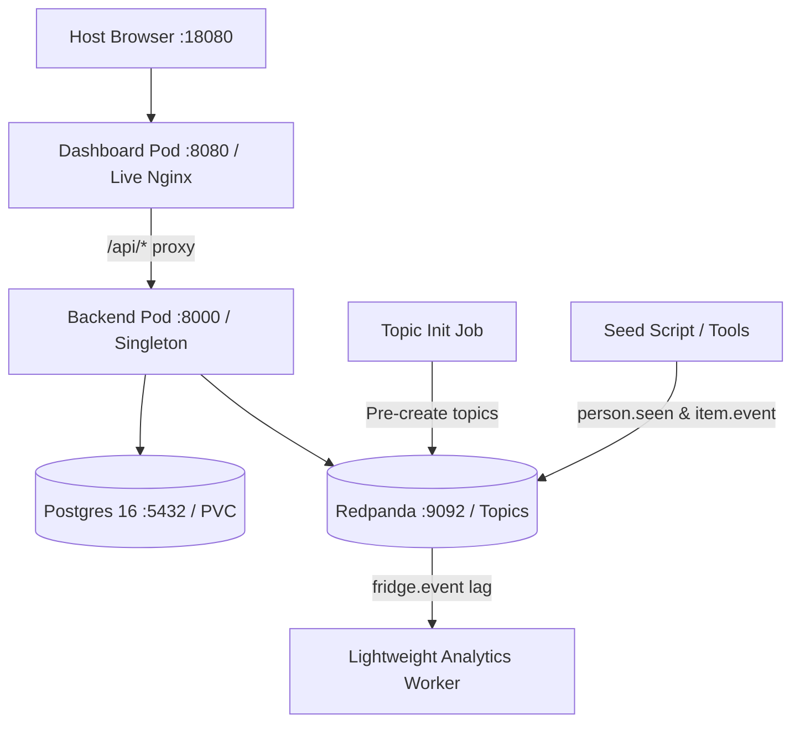

# Lead review — planning only, not implemented

Saved at the 2026-11-07 wrap-up. The direction below is reviewed, but these corrections are mandatory before code:

- Keep the user's default Kubernetes context unchanged. Use a dedicated kubeconfig and explicit context; k3d creation must disable default kubeconfig update/context switching.
- Host port19092 is occupied by the review broker. Do not reuse it. Connect loopback18080 to an actual NodePort30080 or configured ingress; mapping to port80 alone is insufficient.
- Deploy broker/Postgres first, wait for topic bootstrap, then start backend/dashboard (or provide a real dependency init gate). Applying all manifests together does not enforce ordering.
- Preserve backend migration paths; use a nonroot runtime. Postgres uses Recreate and durable storage. Cleanup targets only the dedicated cluster and does not delete unrelated images or resources.
- Three brokers need per-pod advertised DNS, RPC seeds, and verified replication-factor migration of existing topics, including relevant internal consumer-offset data. Merely changing replica count/default RF is insufficient.
- Broker runtime memory must fit its container limit. Count k3s, review containers, and observability against Docker's8GB allocation.
- Keep backend singleton. A KEDA consumer needs a useful independent purpose and group (e.g. contract validation/event metrics), with topic partitions sufficient for intended scaling. No invented backend scaling contract.
- Core fake-event path first, then three-broker recovery, then KEDA/Prometheus/Grafana. Physical camera validation belongs to teammates. Video remains deferred.
- Verify pinned tool/chart/image versions against official docs before installation. Starting references: https://k3d.io/stable/ ; https://docs.redpanda.com/streaming/current/deploy/redpanda/kubernetes/k-requirements/ ; https://keda.sh/docs/2.21/scalers/apache-kafka/ . These links are references, not evidence of a deployed cluster.

The worker was interrupted while revising its plan. The draft below is not accepted implementation or permission to skip the corrections.

---

# Infrastructure Implementation Plan: Local k3d Fridge Tracker

## Goal Description
Deploy a reproducible, local-CPU Kubernetes (`k3d`) environment for Fridge Tracker under Docker’s 8 GB RAM / 8 CPU limit. Provide a singleton backend, Postgres, Redpanda, and live Nginx dashboard with seeded fake event verification (`PUT`/`TAKE`/`wrong_owner`), followed by a 3-broker replicated Redpanda chaos test and KEDA consumer lag scaling as time permits.

## User Review Required
> [!IMPORTANT]
> - **Backend Singleton Guarantee**: Backend matching engine and journal replay are strictly unsafe for concurrent horizontal replicas. Replicas must be locked to `1` with strategy `Recreate`. KEDA is prohibited on the backend.
> - **Zero Shared Edits**: All infrastructure files reside exclusively in `infra/k8s/`. Contracts, backend, and dashboard sources remain unmodified.
> - **Context Isolation**: k3d uses an explicit kubecontext (`k3d-fridge-cluster`) and namespace (`fridge-dev`). No host port 5432 conflict.

## Resource Budget (8 GB RAM / 8 CPU Docker Limit)
| Component | Pods | CPU Req / Limit | Memory Req / Limit | Role / Profile |
| :--- | :--- | :--- | :--- | :--- |
| **k3d System** (k3s, coredns, traefik) | - | 500m / 1000m | 512 Mi / 1024 Mi | Cluster baseline |
| **Postgres 16** | 1 | 250m / 500m | 256 Mi / 512 Mi | Durable PVC (1Gi) |
| **Redpanda** (Phase 1: 1-node) | 1 | 500m / 1000m | 1024 Mi / 1536 Mi | `--smp 1 --memory 1G` |
| **Redpanda** (Phase 2: 3-broker) | 3 | 300m / 500m ea | 768 Mi / 1024 Mi ea | Replicated cluster |
| **Backend Singleton** | 1 | 250m / 500m | 384 Mi / 768 Mi | Replay + Uvicorn |
| **Dashboard (Nginx)** | 1 | 100m / 200m | 128 Mi / 256 Mi | Static + reverse proxy |
| **KEDA Worker** (Phase 3) | 1–3 | 100m / 250m ea | 128 Mi / 256 Mi ea | Downstream lag consumer |
| **Total Core (Phase 1)** | 4 | **1.6 CPU req** | **2.3 GiB RAM req** | Safe within 8 GB / 8 CPU |

---

## Proposed Changes (`infra/k8s/` Only)

### Packaging & Build Artifacts
#### [NEW] `infra/k8s/backend.Dockerfile`
- Multi-stage build with `ghcr.io/astral-sh/uv:python3.11-bookworm-slim`.
- Root build context (`.`) to copy `contracts/` and `services/backend/` without modifying source.
- Installs with `uv sync --frozen --no-dev`.
- Preserves migration paths (`services/backend/migrations/*.sql`) and JSON Schema contract resolution.

### Manifests: Core Pipeline (`infra/k8s/base/`)
#### [NEW] `infra/k8s/base/kustomization.yaml` & `namespace.yaml`
- Namespace `fridge-dev`. Explicit resource references.
#### [NEW] `infra/k8s/base/postgres.yaml`
- Deployment (`replicas: 1`), ClusterIP service `postgres:5432`, `ReadWriteOnce` PVC (`pgdata-pvc`, 1Gi).
#### [NEW] `infra/k8s/base/redpanda.yaml`
- 1-broker StatefulSet, dev-container mode, ports 9092/9644.
#### [NEW] `infra/k8s/base/init-topics-job.yaml`
- Kubernetes Job using `rpk` container: runs `rpk topic create person.seen item.event fridge.event` with exit 0 before backend launches.
#### [NEW] `infra/k8s/base/backend.yaml`
- Deployment: `replicas: 1`, `strategy: {type: Recreate}`.
- Depends on pre-created topics and Postgres.
- **Probes**:
  - `startupProbe`: `httpGet` `/events?limit=1` on port 8000 (`failureThreshold: 30`, `periodSeconds: 2` allows 60s for DB migration & journal replay).
  - `readinessProbe`: `httpGet` `/events?limit=1` (`periodSeconds: 3`).
  - `livenessProbe`: `httpGet` `/events?limit=1` (`periodSeconds: 5`, detects 503 from failed worker loop).
- Environment: `POSTGRES_DSN`, `KAFKA_BOOTSTRAP_SERVERS=redpanda:9092`, `API_PORT=8000`.
#### [NEW] `infra/k8s/base/dashboard.yaml`
- Deployment (`replicas: 1`), Service port 8080 (mapped to host 18080 via k3d).
- Runs Nginx container (non-root 101), static `/healthz`, reverse proxies `/api/` to `http://backend:8000/`.

### Overlays (`infra/k8s/overlays/`)
#### [NEW] `infra/k8s/overlays/replicated-redpanda/`
- StatefulSet override: 3 replicas, partition replication factor 3.
#### [NEW] `infra/k8s/overlays/keda-worker/`
- Separate lightweight CPU-bound consumer in distinct consumer group (`fridge-analytics-worker`) reading `fridge.event`.
- KEDA `ScaledObject` scaling worker pods from 1 to 3 on Kafka consumer lag.

### Finite Automation Scripts (`infra/k8s/scripts/`)
#### [NEW] `infra/k8s/scripts/01-cluster-up.sh`
- Creates k3d cluster `fridge-cluster` mapping host `18080:80` (dashboard) and `19092:19092` (optional direct Kafka access).
- Sets context `k3d-fridge-cluster`.
#### [NEW] `infra/k8s/scripts/02-build-import.sh`
- Builds `fridge-backend:local` and `fridge-dashboard:local`, runs `k3d image import`.
#### [NEW] `infra/k8s/scripts/03-deploy-core.sh`
- Applies `infra/k8s/base`, waits for topic Job completion and pod readiness.
#### [NEW] `infra/k8s/scripts/04-seed-verify.sh`
- Executes finite scenario: publishes `p_01` PUT milk carton, then `p_02` TAKE milk carton.
- Asserts `/api/inventory` reflects ownership and `/api/alerts` logs `wrong_owner`.
#### [NEW] `infra/k8s/scripts/05-chaos-redpanda.sh`
- Applies 3-broker overlay, kills active leader broker pod with `kubectl delete pod`, asserts self-healing without event loss.
#### [NEW] `infra/k8s/scripts/06-teardown.sh`
- Deletes `fridge-cluster`, clears local images and test state.

---

## Verification Plan

### Phase 1: Core Verification (30 min)
1. **Cluster Up & Image Import**: `01-cluster-up.sh` & `02-build-import.sh`.
2. **Topic Pre-creation**: Confirm `init-topics-job` completed before backend starts.
3. **Backend Readiness & Replay**: Confirm backend passes startup probe without restart loops.
4. **Seed Execution**: Run `04-seed-verify.sh`.
5. **Contract & UI Smoke**:
   - `curl -sf http://localhost:18080/api/inventory` -> verifies item in fridge.
   - `curl -sf http://localhost:18080/api/alerts` -> verifies `wrong_owner` alert for `p_02`.
   - `curl -N http://localhost:18080/api/stream` -> receives SSE `fridge.event` with `status: wrong_owner`.
   - Browser check at `http://localhost:18080` confirms dashboard renders live data.

### Phase 2: 3-Broker Redpanda & Chaos Test (15 min)
1. Apply replicated overlay: `kubectl apply -k infra/k8s/overlays/replicated-redpanda`.
2. Terminate broker-0: `kubectl --context k3d-fridge-cluster -n fridge-dev delete pod redpanda-0`.
3. Assert producer/consumer recover under Raft leader election without journal corruption.

### Phase 3: KEDA Lag Scaling (Time Permitting, 15 min)
1. Deploy KEDA Helm chart & `keda-worker` overlay.
2. Publish burst of 100 fake events; observe consumer group lag rise and HPA scale worker pods from 1 to 3.
